# CODEROT

**A 3rd-person hero shooter MOBA for Roblox, set inside a corrupted codebase.**

Two teams fight to protect their **Kernel**: **The Compilers** (clean code, blue/white neon) against **The Rot**
(brainrot-corrupted code, purple/magenta glitch). The kill feed reads like a crash log, minions are *Packets*, the
currency is *Bytes*, and the voice lines include "it works on my machine", "who pushed to prod" and "skill issue".

> This repo is a showcase of the project: art, design and tooling. The game's source code is kept private.

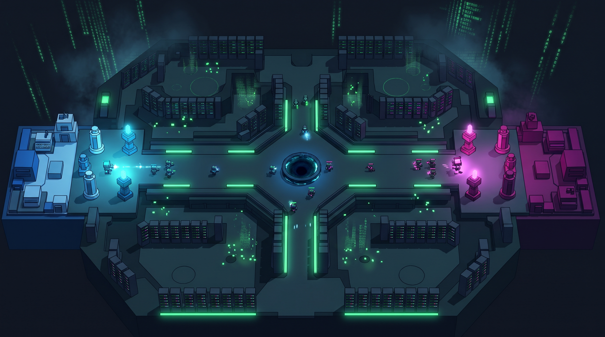

---

## What I built

- **3 game modes**, chosen from a lobby hub:
  - **CODEBASE**: the main 6v6 mode, with multiple lanes, a jungle full of neutral camps, a mid boss, and a two-phase Kernel fight.
  - **RANDOM_SEED**: a 5v5 single-lane mode with random heroes and run-changing augments.
  - **MERGE CONFLICT**: a 4v4 round-based mode with an item draft.
- **12 heroes**, each with its own gun, 4 abilities that upgrade in tiers, and its own look.
- **A custom movement system**: momentum, sliding, wall-running, dashes, double jumps, data rails and zip lines. It runs on a fixed-rate simulation, so movement behaves the same at any frame rate.
- **Server-authoritative combat**: damage, HP, economy, items and cooldowns all live on the server, and hits are validated with lag compensation.
- **A shop and economy** with an item system, plus bots that lane, push, retreat and use their abilities, so matches can be filled and tested solo.
- **Procedural maps**: every map is built from code with layout data, so the game runs with no hand-placed level geometry.
- **TRAINING.exe**: an interactive tutorial course that teaches the movement tech station by station, with checkpoints.
- **Progression and persistence**: account level, a progression track, cosmetics, settings and match stats saved with DataStores.
- **PC, mobile and gamepad** input support.

## Heroes

| | Hero | Role | | Hero | Role |
|---|---|---|---|---|---|
| 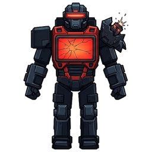 | **SEGFAULT** | Bruiser | 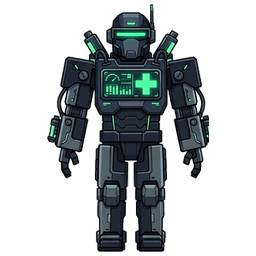 | **HOTFIX** | Support / healer |
| 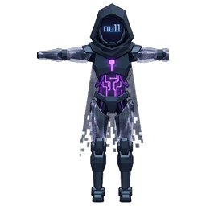 | **NULL POINTER** | Assassin | 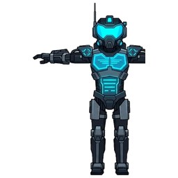 | **REGEX** | Sniper |
| 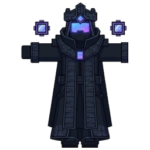 | **RECURSION** | Summoner | 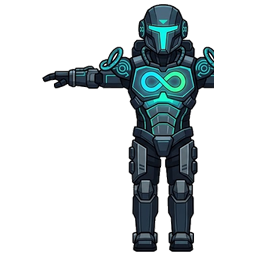 | **INFINITE LOOP** | Duelist |
| 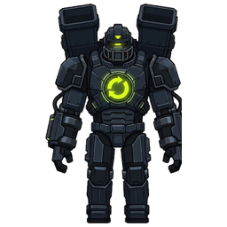 | **GARBAGE COLLECTOR** | Tank | 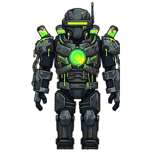 | **MEMORY LEAK** | Damage-over-time mage |
| 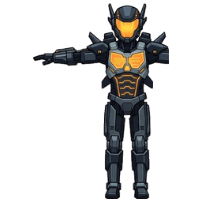 | **RACE CONDITION** | Speedster | 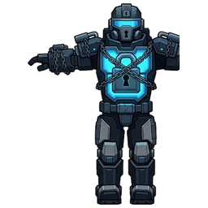 | **MUTEX** | Zone denial |
| 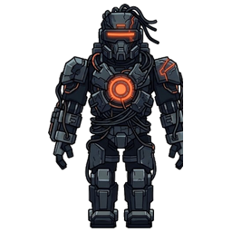 | **SPAGHETTI** | Controller | 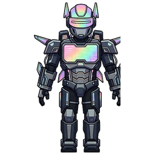 | **VIBE CODER** | Chaos mage |

### Weapons

Every hero has a signature weapon: the Core Dumper, Patch Gun, Railgun, Silenced SMG, Mirror Wand, Slow Cannon, Dual
Pistols, Noodle Spray, Lockdown Rifle, Burst Rifle, Acid Staff and Autocomplete Wand.

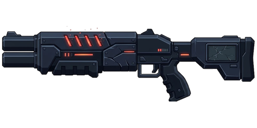 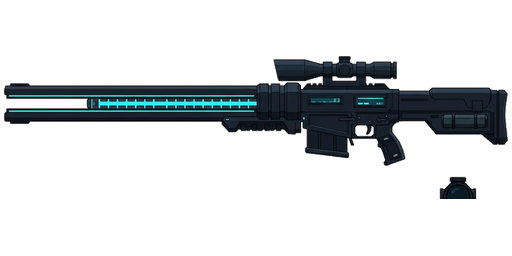 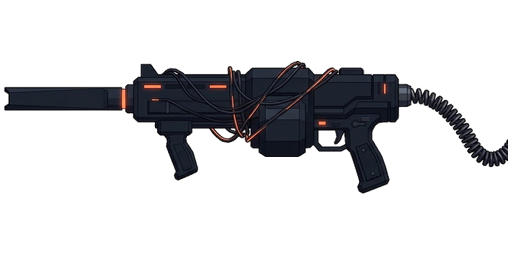

## World

| | |
|---|---|
| 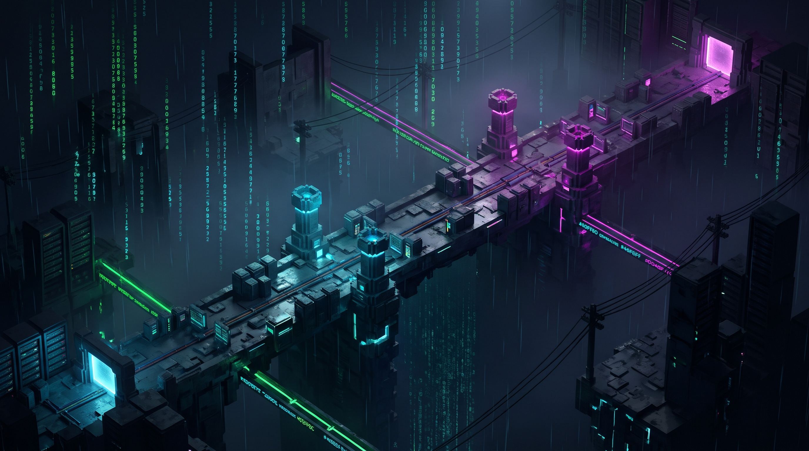 | 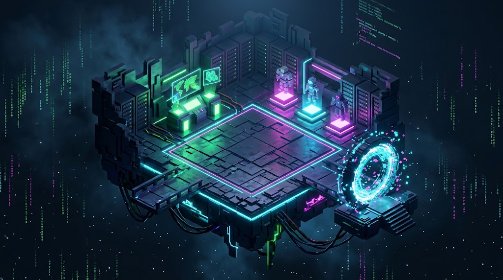 |
| 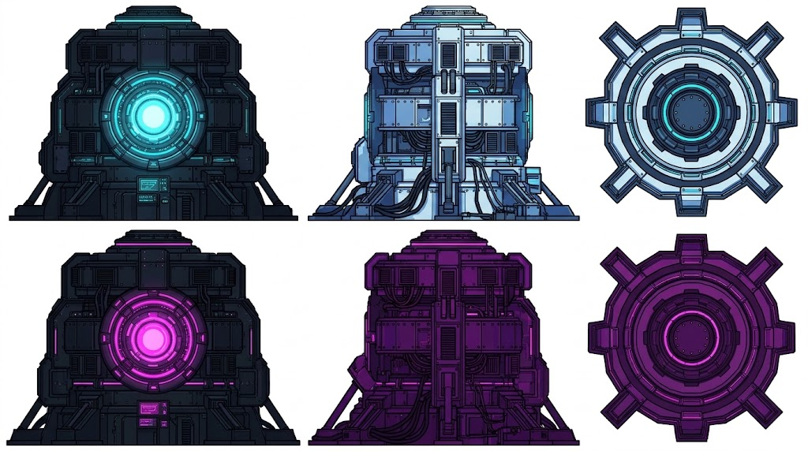 | 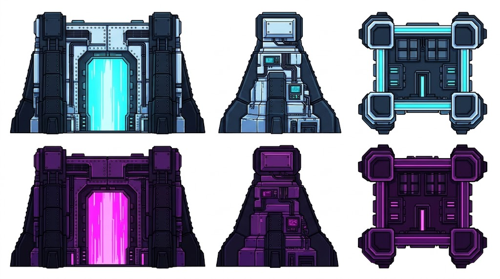 |

Neutral camps include `deprecated()`, a jQuery plugin, the MONOLITH and the Titan.

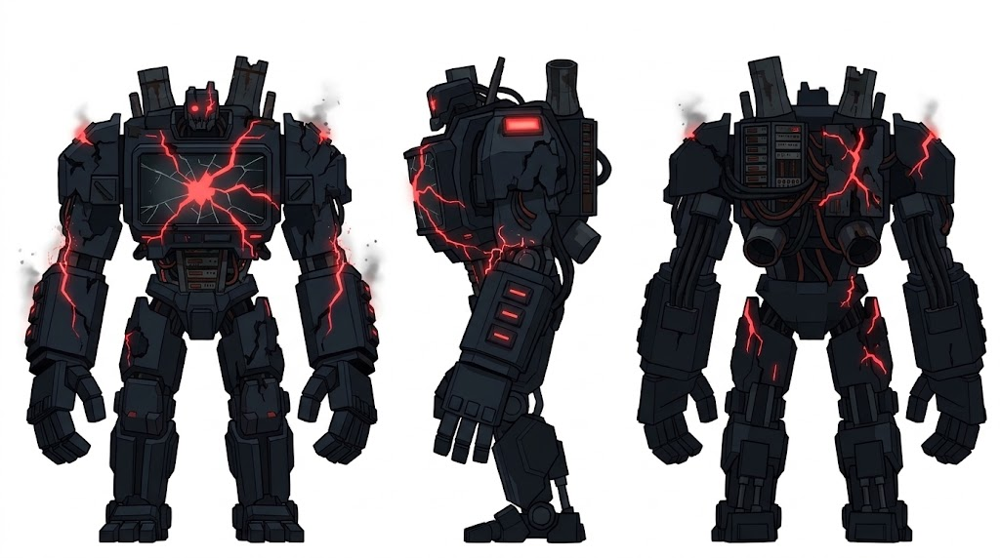

## Tech & pipeline

| Area | Tools |
|---|---|
| Game code | **roblox-ts** (TypeScript compiled to Luau), **Rojo** for syncing into Roblox Studio |
| Architecture | Auto-loaded server services and client controllers, a single networking module, all tunable numbers kept in config modules |
| 3D assets | **Blender**, driven entirely by **Python** scripts that generate the weapon meshes, VFX meshes and animation clips |
| Art | Concept sheets generated with **Gemini** from my prompts, then cut into textures, portraits and icons with a Python/Pillow script |
| Testing | Roblox Studio, driven through the Studio MCP for automated play-testing |

The Blender scripts build every weapon mesh and 20 animation clips (slide, wall-run, dash, rail, reloads, melee swings,
ability casts) procedurally, then render preview sheets to check them:

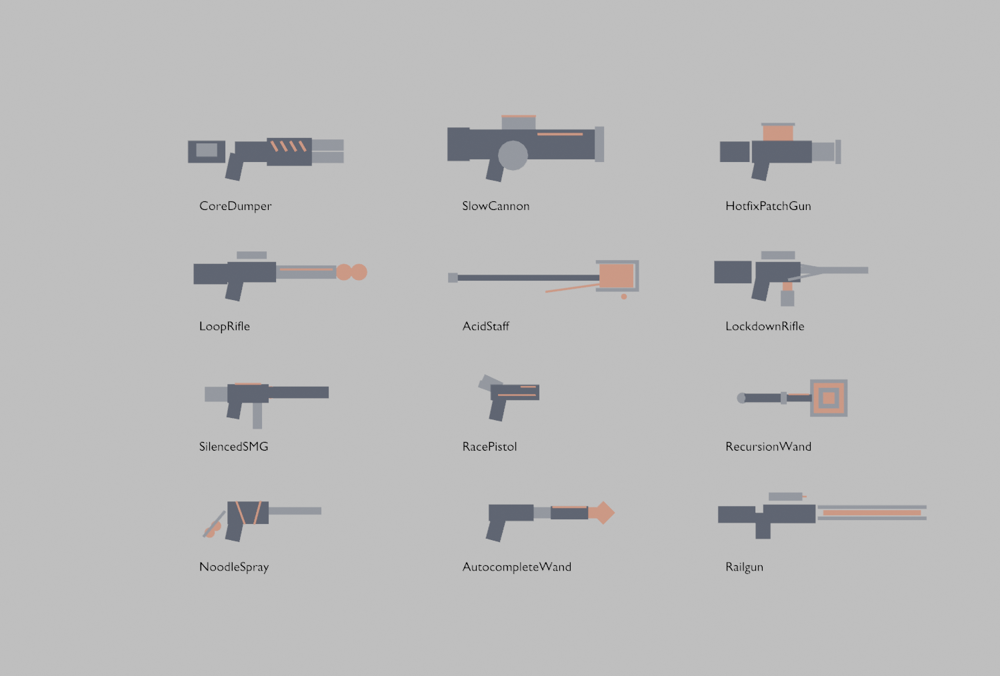

Animation clip preview (20 clips, 5 frames each)

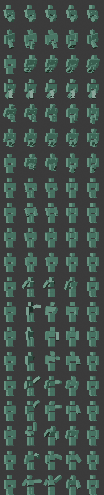

[`samples/`](samples) contains two of the pipeline scripts: the image preparation script and the Blender preview
renderer.

## Status

All 9 build phases are done (all 3 modes and all 12 heroes). The game is now in play-testing and balance tuning.

---

© 2026 bleydz. All rights reserved. See [LICENSE](LICENSE).
